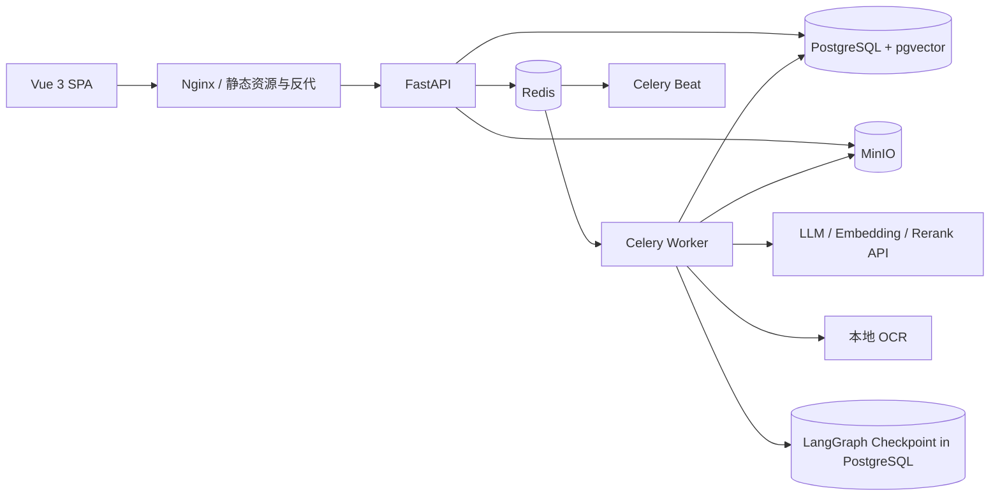
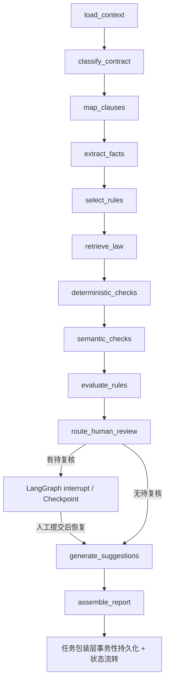

# 企业级合同审查 Agent —— 设计文档

- **状态**：待用户审阅
- **日期**：2026-10-19
- **版本**：v1.0
- **技术栈**：FastAPI · LangGraph · Celery · PostgreSQL + pgvector · Redis · MinIO · Vue 3
- **参考**：RAGFlow 的设计思想（结构优先解析、模板化分块、混合检索、重排）。仅参考在线资料，不拉取或克隆其代码。

---

## 1. 目标与范围

### 1.1 背景

面向法律/合同场景，建设一个企业级合同审查 Agent MVP。系统以企业标准合同模板、审查清单、内部风控规则为主要业务判断依据，以现行有效且适用的法律法规、司法解释为合规依据，通过 RAG 检索、条款对比和确定性规则引擎完成风险判断。LLM 只负责文档理解、结构化抽取、语义对比与有依据的文本生成，不独立作出最终法律判断。

### 1.2 目标

- 在 Web 界面完成：合同上传 → 异步解析 → 规则/法规检索 → LangGraph 审查 → 风险项与证据 → 人工复核 → 报告与导出。
- 每个风险项可追溯到合同原文（页码/坐标）、规则版本、法规版本与具体条文。
- 支持多租户、三角色 RBAC + 资源级 ACL、审计。
- 证据不足、检索失败、法规未核验/失效、规则未覆盖、低置信度等情况自动转人工，绝不自动判定为通过。
- 可运行、可恢复、可追溯、可评测；单机 Docker Compose 部署，后续可扩展 CI/CD。

### 1.3 非目标（MVP）

- 不提供自由问答入口；知识库与检索仅服务于合同审查。
- 不提供合同起草、自动修改并回写原文件、自动签署或法务决策替代。
- 不接入外部法规数据库 API；法规由管理员上传、人工核验后发布。
- 不做企业 SSO/LDAP（数据模型预留扩展）。
- 不拆微服务、不引入 K8s、不新增数据库或额外基础设施。

### 1.4 成功标准

1. 完成单份合同（电子 PDF、扫描 PDF、DOCX）从上传到报告导出的完整闭环。
2. 审查结论中不存在无证据支持的风险项；所有引用均可定位原文。
3. 强制人工复核条件 100% 被路由，不得漏转。
4. 审查可在人工复核阶段暂停并恢复，等待期间不占用 Celery Worker。
5. 面向同一合同与同一版本依赖的审查结果可复现；实质变化必须创建新审查运行。
6. `tests/harness` 中安全、权限、租户隔离、幂等、证据与人工复核硬性门槛全部通过。

---

## 2. 总体架构

### 2.1 架构原则

- **模块化单体**：单服务部署，模块通过 Service 接口协作，不拆微服务。
- **判定权在 Rules Engine**：LLM 只输出结构化事实、语义关系和可验证证据；严重等级与风险结论仅由 Rules Engine 产生。
- **证据优先、Fail-closed**：证据无法校验或结果不确定时转人工，不自动放行。
- **不可变快照**：合同、模板、规则、法规、审查依据、决策记录均采用不可变版本设计。
- **状态分离**：任务执行状态与合同审查业务状态分开管理。
- **可靠异步**：Celery 执行任务，Outbox 保证事件投递，消费者幂等。
- **可替换接口**：OCR、LLM、Embedding、Rerank、检索后端均通过接口隔离。

### 2.2 技术栈

| 层次 | 选型 |
|---|---|
| 后端 | Python 3.12+、FastAPI、Pydantic v2 |
| 编排 | LangGraph（含 PostgreSQL Checkpointer） |
| 异步任务 | Celery + Redis（Broker/Result） |
| 业务数据库 | PostgreSQL 16+、SQLAlchemy 2.0、Alembic |
| 检索 | pgvector + 中文全文检索（MVP 默认 `pg_bigm`，可切换 ParadeDB `pg_search` BM25；接口不变） |
| 对象存储 | MinIO（私有 Bucket） |
| 前端 | Vue 3 + TypeScript + Vite + Tailwind CSS + shadcn-vue + Pinia + TanStack Query + PDF.js |
| 本地 OCR | PaddleOCR/PP-Structure 等本地实现，通过 `OCRProvider` 接口可插拔 |
| 模型 | 国内云端 API（DeepSeek/通义等），通过 `LLMProvider`、`EmbeddingProvider`、`RerankProvider` 路由 |
| 部署 | Docker Compose（api、worker、beat、frontend/nginx、postgres、redis、minio） |

### 2.3 模块边界

| 模块 | 职责 | 不负责 |
|---|---|---|
| `auth` + 权限守卫 | JWT、租户、RBAC、ACL、资源级授权 | 业务逻辑 |
| `contracts` | 合同上传、版本、元数据、访问控制 | 解析、审查 |
| `parsing` | 文本提取、OCR、版面/表格、坐标、条款树、条款分类 | 检索、规则判断 |
| `knowledge` | 模板/规则/法规生命周期：草稿→审核→发布→退役 | 检索打分 |
| `retrieval` | 分块、Embedding、混合检索、重排、父子块扩展 | 知识发布/版本管理 |
| `review` | LangGraph 业务编排层 | 具体业务实现、风险判定 |
| `review/rules_engine` | 确定性规则执行、风险等级、DecisionRecord | 语义理解 |
| `review_workbench` | 人工复核队列、决策、暂停/恢复 | 自动判定 |
| `reports` | 结构化报告、Word/PDF 导出 | 审查结论生成 |
| `audit` | 关键操作、审查依据、人工复核记录 | 业务状态 |
| `tasks` | Celery 编排、进度、重试、幂等 | 审查业务逻辑 |
| `llm` | 模型路由、结构化输出校验、证据校验、Prompt 版本 | 风险判断 |
| `tests/harness` | 硬性门槛、质量评测、回归 | 生产运行时逻辑 |
| `frontend` | 上传、进度、报告、知识管理、复核工作台 | 权限最终裁决 |

### 2.4 部署拓扑



- Outbox Dispatcher 由 Celery Beat 周期触发；不使用额外消息中间件。
- 队列按任务类型划分：`parse`、`review`、`resume`、`index`、`report_export`；不同队列设置独立并发与超时。
- Worker 不持有跨任务状态；人工复核等待不占用 Worker。

---

## 3. 审查工作流

### 3.1 12 个业务节点

`finalize` 不是业务节点，由任务包装层负责最终持久化与状态流转。



| # | 节点 | 输入 | 输出 | 失败/不确定 |
|---|---|---|---|---|
| 1 | `load_context` | 合同版本、模板/规则/法规/模型/配置版本、操作者权限快照 | `ReviewContext` + 不可变 `ReviewRunManifest` | 版本缺失/未发布 → `failed` |
| 2 | `classify_contract` | 解析文档摘要、元数据 | `ContractClassification` | 类型歧义/低置信度 → 人工 |
| 3 | `map_clauses` | 解析文档、分类结果、模板版本 | `ClauseMap`（条款树、类型、对齐、原文坐标） | 解析缺失/歧义 → 人工 |
| 4 | `extract_facts` | 条款树、字段 Schema | `FactSet`（值、单位、证据、冲突标记） | 冲突/证据失败 → 人工 |
| 5 | `select_rules` | 合同类型、规则集版本 | `RuleSelection`、覆盖清单 | 无规则 → 报告“规则未覆盖”，不得判通过 |
| 6 | `retrieve_law` | 规则的 `legal_basis`、适用日期 | `LawRetrievalResult` | 按下表处理；检索失败 ≠ 无风险 |
| 7 | `deterministic_checks` | 规则、事实、条款树 | `CheckResult[]`（不含 severity） | 缺前置事实 → `insufficient_evidence` |
| 8 | `semantic_checks` | 规则、条款、模板、法条、证据 | `SemanticResult[]`（不含最终结论） | 证据失败/低置信度 → 人工 |
| 9 | `evaluate_rules` | 确定性结果 + 语义结果 + 法规结果 + 规则 | `EvaluationResult`：风险项、`DecisionRecord`、覆盖率、复核原因 | 仅此节点写 `rule_severity` |
| 10 | `route_human_review` | 风险项、复核原因 | `HumanReviewDecision`（interrupt/resume） | 有待复核 → 暂停；无 → 继续 |
| 11 | `generate_suggestions` | 风险项、模板条款、已确认证据 | `Suggestion[]`（标注参考建议） | 校验失败 → 仅展示依据 |
| 12 | `assemble_report` | 全部结构化结果 | `ReportPayload` | 持久化由包装层负责 |

### 3.2 法规检索状态

| 状态 | 含义 | 处理 |
|---|---|---|
| `found_applicable` | 找到并确认现行有效、已核验、适用 | 进入语义对比 |
| `not_applicable_confirmed` | 依据元数据确定不适用 | 规则记 `not_applicable`，必须附理由；无法确定转人工 |
| `not_found` | 检索完成但未匹配条文 | `insufficient_evidence` → 人工 |
| `retrieval_failed` | 后端超时/索引不可用 | 重试；仍失败 → `insufficient_evidence` → 人工；不得视为无风险 |
| `expired_or_repealed` | 已失效/废止 | 尝试已映射的替代版本；否则人工；禁止用于正式审查 |
| `unverified_version` | 版本未核验 | 禁止使用 → 人工 |
| `ambiguous_version` | 多版本/适用范围不确定 | 人工 |

### 3.3 ReviewRunManifest

审查开始时由 `load_context` 生成，固定所有依赖版本与内容哈希：

```python
class VersionRef(FrozenModel):
    id: UUID
    version_no: int
    content_hash: Sha256Hex

class ParsedDocumentRef(FrozenModel):
    id: UUID
    parse_no: int
    content_hash: Sha256Hex
    parser_config_version_id: UUID

class LawVersionRef(VersionRef):
    law_id: UUID
    verification_status: LawVerificationStatus
    effective_from: datetime
    effective_to: datetime | None

class ReviewRunManifest(FrozenModel):
    manifest_id: UUID
    run_id: UUID
    tenant_id: UUID
    contract_version: VersionRef
    parsed_document: ParsedDocumentRef
    template_version: VersionRef
    rule_set_version: VersionRef
    law_versions: tuple[LawVersionRef, ...]
    model_config_version: VersionRef
    prompt_versions: tuple[VersionRef, ...]
    parser_config_version: VersionRef
    app_config_version: VersionRef
    graph_version: str
    created_by: UUID
    created_at: datetime
    manifest_hash: Sha256Hex
```

- `manifest_hash`：对不含自身字段的规范化 JSON（键排序、UTF-8）计算 SHA-256。
- 数据库触发器禁止更新/删除；合同或依据实质变化必须新建审查运行。
- 恢复、导出、审计均校验 Manifest 哈希。

### 3.4 ReviewState

```python
class ReviewState(StrictModel):
    schema_version: Literal["review_state.v1"] = "review_state.v1"
    run_id: UUID
    thread_id: str
    manifest: ReviewRunManifest

    contract_context: ContractContext
    classification: ContractClassification | None = None
    clause_map: ClauseMap | None = None
    facts: FactSet | None = None
    rule_selection: RuleSelection | None = None
    law_results: LawRetrievalResult | None = None
    deterministic_results: list[CheckResult] = Field(default_factory=list)
    semantic_results: list[SemanticResult] = Field(default_factory=list)
    evaluation: EvaluationResult | None = None
    human_review: HumanReviewState | None = None
    suggestions: list[Suggestion] = Field(default_factory=list)
    report: ReportPayload | None = None

    node_runs: Annotated[list[NodeRunRecord], operator.add] = Field(default_factory=list)
    warnings: Annotated[list[ReviewWarning], operator.add] = Field(default_factory=list)
    errors: Annotated[list[ReviewError], operator.add] = Field(default_factory=list)
```

- `thread_id = str(run_id)`，使用 PostgreSQL Checkpointer。
- 节点返回状态增量；原始文件与完整正文只存 MinIO/数据库引用。
- `schema_version` 不兼容时拒绝恢复，标记 `needs_rerun`。

### 3.5 Rules Engine

规则采用 `YAML/JSON + Pydantic 校验 + 类型化 Handler`，MVP 不做通用表达式 DSL。

| 规则类型 | 依据 | 判定方式 |
|---|---|---|
| `required_clause` | 审查清单/模板 | 条款类型是否存在 |
| `forbidden_semantic` | 内部风控规则 | 语义谓词 + 有效证据 |
| `numeric_threshold` | 内控/法规 | 抽取数值 + 确定性比较 |
| `date_logic` | 内控 | 日期/期限确定性校验 |
| `template_deviation` | 标准模板 | 模板偏离类型 + 规则阈值 |
| `legal_compliance` | 法规/司法解释 | 法条关系：一致/冲突/不确定 |
| `cross_clause_consistency` | 内部规则 | 跨条款事实一致性 |

```python
class RulesEngine(Protocol):
    def run_deterministic(
        self, *, rules: RuleSelection, facts: FactSet, clause_map: ClauseMap
    ) -> tuple[CheckResult, ...]: ...

    def evaluate(
        self, *,
        rules: RuleSelection,
        facts: FactSet,
        clause_map: ClauseMap,
        checks: Sequence[CheckResult],
        semantics: Sequence[SemanticResult],
        laws: LawRetrievalResult,
        eval_meta: EvaluationMeta,
    ) -> EvaluationResult: ...
```

- `run_deterministic` 只输出事实与检查结果，不产生风险项或等级。
- `evaluate` 是唯一生成 `RiskItemDraft`、`rule_severity`、`DecisionRecordDraft`、`CoverageItem` 的路径。
- 纯同步、无 I/O、可重复执行；时间与 ID 由 `eval_meta` 注入。

### 3.6 LLM 契约与证据校验

- LLM 输出使用 Pydantic/JSON Schema 强约束，`extra="forbid"`。
- Schema 中不存在 `severity`、`risk_level`、`final_conclusion`；出现额外字段即校验失败。
- 每次调用记录 `ModelRun`：模型配置版本、Prompt 版本、输入/输出哈希、token、延迟、请求 ID。
- 证据校验三项全部通过才可使用：
  1. **原文定位**：`quote` 能在固定的 `document_nodes` 中定位到条款/字符区间/坐标。
  2. **内容一致性**：规范化文本匹配达到阈值；OCR 场景允许配置的模糊匹配；`source_hash` 必须一致。
  3. **依据相关性**：合同证据必须属于规则目标条款（或规则允许的交叉引用）；法条证据必须属于本次 Manifest 固定的适用法规版本与条文；模板证据必须属于固定模板版本。
- 任一项失败 → `EVIDENCE_INVALID` → 人工复核；不得进入自动通过。
- LLM 置信度仅用于复核路由，不参与风险等级计算。

### 3.7 人工复核与 Checkpoint

- `route_human_review` 在存在待复核项时调用 LangGraph `interrupt()`；状态写入 Checkpoint，Celery 任务以 `outcome=interrupted` 结束并释放 Worker。
- 业务状态置为 `awaiting_human`；待复核任务写入 `human_review_tasks`。
- 复核提交后，`resume_review` 任务校验：权限 → 业务状态 → Manifest 哈希 → `review_runs.version` 乐观锁 → 幂等键 → 所有待复核项均有决策；通过后从 Checkpoint 恢复。
- 所有待复核项必须明确处理（确认/驳回/调整等级/标记未解决/标记误报/新增人工风险）；“未解决”必须由人工显式标记并记录理由。
- 图/Prompt/配置版本不兼容 → `needs_rerun`，不错误恢复。
- 复核等待超时触发提醒与升级，不自动放行；管理员可在留下审计记录后关闭为 `completed`（含未解决项），报告中明确展示。

### 3.8 报告、持久化与异常终态

**报告内容**（`ReportPayload`）必须包含：

- 审查基本信息：合同/版本、审查运行、Manifest 哈希、使用的模板/规则/法规/模型/Prompt 版本；
- 总体结论与风险摘要（按高/中/低统计，注明“完成”不等于“无风险”）；
- 逐条风险项：等级、条款原文位置（页码/段落/坐标）、规则依据、法规依据（版本/条文/原文）、DecisionRecord 摘要；
- 修改建议（仅基于模板条款，标注“参考建议，需法务确认”）；
- 人工复核记录：复核人、时间、决策、理由、等级调整；
- 覆盖率与未解决项：未执行/证据不足/未覆盖的规则清单；
- 自动确认与人工确认状态。

`assemble_report` 只生成结构化内容；任务包装层在同一事务中持久化风险项、报告元数据、审计事件和业务状态，成功后更新为 `completed`。Word/PDF 导出由独立异步任务生成，失败可重试，不影响结构化报告。

**异常终态映射**（不得静默降级）：

| 错误 | 处理 | 终态/路径 |
|---|---|---|
| 版本缺失/未发布/Manifest 不一致 | 不启动或拒绝恢复 | `failed` / `needs_rerun` |
| 解析失败且重试耗尽 | 记录节点与错误 | `failed`；允许人工重新解析 |
| 法规检索失败/未命中/未核验/失效 | 受影响规则 `insufficient_evidence` | 人工复核 |
| 证据定位/内容/相关性校验失败 | 丢弃该语义结果 | 人工复核 |
| LLM/Schema 重试耗尽 | 记录模型与 Prompt 版本 | 人工复核或 `failed`（按规则） |
| 规则未覆盖 | 覆盖率缺口 | 报告标记，人工复核 |
| 人工复核超时 | 提醒/升级 | 保持 `awaiting_human`；管理员可审计后关闭 |
| 持久化失败 | 事务回滚 | 保持原状态并重试；不提前流转 |

---

## 4. 数据模型与一致性

### 4.1 租户与权限

- 所有业务表带 `tenant_id NOT NULL`。
- 聚合根增加 `UNIQUE (tenant_id, id)`；子表使用 `(tenant_id, parent_id)` 复合外键，防止跨租户引用。
- 角色：管理员、法务审查员、业务提交者；资源级 ACL。
- 应用层强制 RBAC + ACL；Service 层二次校验。上线前启用 PostgreSQL RLS 作为第二道防线（同一数据库，无新增基础设施）。
- 后台任务在事务开始前设置 `app.tenant_id`，禁止一个事务跨租户。

### 4.2 不可变快照 / 可变治理 / 运行记录

| 层 | 表 | 可变性 |
|---|---|---|
| 内容快照 | `contract_versions`、`contract_files`、`parsed_documents`、`document_nodes`、`template_versions`、`template_clauses`、`rule_set_versions`、`rule_definitions`、`law_versions`、`law_articles` | 只插入 |
| 治理状态 | `contract_parse_states`、`template_version_governance`、`rule_set_version_governance`、`law_version_governance` | 状态、审批、当前指针、退役/替换 |
| 运行状态 | `review_runs`、`risk_items`、`human_review_tasks`、`task_runs`、`index_targets` | 按状态机更新 |

- `parsed_documents` 不可更新；`contract_parse_states` 保存 `current_parsed_document_id`、`parse_status`、`last_error`、更新时间。
- 模板/规则集的当前发布版本由 `*_version_governance` 的 `is_current` + 部分唯一索引管理。
- 法规正文与条文不可变；`law_version_governance` 保存状态、核验、生效区间、审批、替代版本。

### 4.3 法规时效与排他约束

- 生效区间为左闭右开 `[effective_from, effective_to)`；`effective_to IS NULL` 表示长期有效。
- 排他约束只作用于正式版本：

```sql
EXCLUDE USING gist (
  law_id WITH =,
  tstzrange(effective_from, COALESCE(effective_to, 'infinity'), '[)') WITH &&
)
WHERE (status = 'published' AND verification_status = 'verified');
```

草稿、未核验、驳回版本不受约束；正式版本之间不得时间重叠。

### 4.4 证据、风险与决策

- `evidence_refs` 使用三个明确外键：`contract_node_id`、`template_clause_id`、`law_article_id`；CHECK 保证恰好引用一个来源。
- Service 进一步校验证据属于本次 Manifest 固定的版本/解析结果。
- `risk_items.rule_severity`：Rules Engine 首次写入，触发器禁止更新。
- `risk_items.effective_severity`：当前生效等级；只能由 Rules Engine 初始化或 `HumanReviewService` 在人工复核中修改，修改必须写 `human_review_records` 与审计。
- `decision_records` 与 `risk_item` 一对一，固化规则版本、输入事实哈希、表达式、证据 ID、结果、路由原因；不可变。

### 4.5 索引目标与执行尝试

- `index_targets`：每个知识版本/索引名称一条，记录目标内容哈希、状态（`pending/indexing/indexed/failed/stale`）、当前已索引哈希；可重试。
- `index_attempts`：每次执行一条，记录 `attempt_no`、`task_run_id`、起止时间、结果、错误、指标；`UNIQUE (index_target_id, attempt_no)`，append-only。
- `retrieval_chunks` 关联 `index_target_id`；重建索引在事务内替换该目标的 chunk 集，失败回滚并保留 attempt 记录。
- 知识发布事务写治理状态 + `index_targets` + Outbox 事件；只有 `indexed` 且内容哈希一致的知识版本可被正式审查引用。

### 4.6 Outbox 与消费幂等

- 业务事务只写 `outbox_events`；Dispatcher 负责投递并更新 `published`，这是第一阶段。
- 消费者处理是独立第二阶段：以 `(consumer_name, event_id)` 在 `consumed_events` 去重；失败重试/死信；成功后写消费记录。
- 发布成功不等于消费成功；索引、审计等跨系统操作均通过此机制。

### 4.7 状态枚举

使用 `TEXT + CHECK`；状态迁移由 Service 显式控制。

| 枚举 | 值 |
|---|---|
| `version_status` | `draft / in_review / published / retired` |
| `parse_status` | `pending / parsing / parsed / failed` |
| `index_status` | `pending / indexing / indexed / failed / stale` |
| `review_run_status` | `created / processing / awaiting_human / completed / failed / cancelled / needs_rerun` |
| `task_run_status` | `queued / running / succeeded / failed / cancelled` |
| `task_run_outcome` | `completed / interrupted / failed` |
| `risk_item_status` | `pending_human / auto_confirmed / human_confirmed / human_rejected / human_modified / unresolved` |
| `human_review_reason` | `low_confidence / evidence_invalid / ambiguous_clause / missing_evidence / law_retrieval_failed / law_not_applicable_uncertain / law_expired / law_unverified / rule_uncovered / model_error / manual_request` |
| `law_verification_status` | `pending / verified / rejected / superseded` |
| `law_retrieval_status` | `found_applicable / not_applicable_confirmed / not_found / retrieval_failed / expired_or_repealed / unverified_version / ambiguous_version` |
| `outbox_status` | `pending / published / failed / dead_letter` |
| `report_status` | `draft / finalized / superseded` |
| `artifact_status` | `queued / generating / ready / failed` |

- `review_run`：`created → processing → awaiting_human → completed`；任一阶段可 `failed / cancelled`；版本不兼容 → `needs_rerun`。
- `risk_item`：`pending_human` → 人工终态；自动项只能为 `auto_confirmed`。
- `completed` 仅表示流程终结，不代表“无风险”；报告必须展示未解决项与覆盖率。

### 4.8 约束与迁移

- 主键 UUIDv7；时间 `timestamptz`；哈希 64 位十六进制。
- 检查：版本号 > 0、`effective_to > effective_from`、坐标非负、字符区间合法、状态取值合法、进度 0–100。
- 不可变表：数据库权限仅 `SELECT/INSERT` + 触发器拒绝 `UPDATE/DELETE`。
- Alembic 迁移覆盖扩展（`vector`、`btree_gist`、`pgcrypto`）、复合外键、CHECK、部分唯一索引、法规排他约束、不可变触发器、授权、索引目标/尝试、Outbox/消费幂等表。
- 生产迁移前备份；以 expand-contract 方式演进；不做破坏性降级。
- 集成测试验证：跨租户引用拒绝、当前发布版本唯一、法规排他仅作用于正式版本、证据恰好一个来源、不可变表拒绝更新、索引重试历史、Outbox 消费幂等、人工恢复重复提交只生效一次。

---

## 5. API 设计

### 5.1 通用约定

- 前缀 `/api/v1`；JSON；UUID；ISO-8601；游标分页。
- Bearer JWT；租户从令牌上下文获取，不接受客户端传入 `tenant_id`。
- 所有资源接口执行 RBAC + ACL；Service 层二次校验。
- 异步接口返回 `202 + resource_id + task_id`。
- 写操作支持 `Idempotency-Key`；相同键不同请求体 → `409`。
- 错误统一：

```json
{"error":{"code":"EVIDENCE_INVALID","message":"...","request_id":"...","details":{}}}
```

### 5.2 认证与安全

- 密码使用 Argon2id；JWT Access Token 15 分钟，Refresh Token 7 天并旋转。MVP 使用 HS256 + 密钥轮换（`kid`）；后续若多服务验签可切换 RS256。
- Refresh Token 哈希存库，支持撤销；检测到重放时撤销整个令牌族。
- 登录限流：Redis 滑动窗口（IP + 用户名）；连续失败锁定并告警。
- 租户切换：`POST /auth/switch-tenant`，校验成员关系后签发新令牌。
- 上传安全：格式白名单（PDF/DOCX/PNG/JPEG）、Magic Bytes、文件大小上限、DOCX 压缩炸弹检查、文件名净化、租户前缀隔离、内容哈希；解析在受限 Worker 中执行，不执行上传内容。
- 下载授权：API 完成 ACL 校验后返回短时签名 URL（≤5 分钟）；MinIO Bucket 私有，禁止公开读。
- CORS 白名单、安全响应头；密钥不进入代码/镜像/日志。

### 5.3 主要端点

| 领域 | 接口 |
|---|---|
| 认证 | `POST /auth/login`、`POST /auth/refresh`、`POST /auth/logout`、`POST /auth/switch-tenant`、`GET /auth/me` |
| 合同 | `POST /contracts`、`GET /contracts`、`GET /contracts/{id}`、`POST /contracts/{id}/versions`、`GET /contract-versions/{id}` |
| 解析 | `POST /contract-versions/{id}/parse`、`GET /contract-versions/{id}/parse-state`、`GET /contract-versions/{id}/document` |
| 审查 | `POST /contract-versions/{id}/reviews`、`GET /reviews`、`GET /reviews/{run_id}`、`GET /reviews/{run_id}/risks`、`GET /reviews/{run_id}/coverage`、`GET /reviews/{run_id}/report`、`POST /reviews/{run_id}/cancel` |
| 人工复核 | `GET /reviews/{run_id}/human-review`、`POST /reviews/{run_id}/human-review/decisions`、`GET /reviews/{run_id}/human-review/history` |
| 任务 | `GET /tasks/{task_id}`、`POST /tasks/{task_id}/events-ticket`、`GET /tasks/{task_id}/events`（SSE）、`POST /tasks/{task_id}/cancel` |
| 模板 | `GET/POST /admin/templates`、`POST /admin/templates/{id}/versions`、`POST /admin/template-versions/{id}/publish`、`POST .../retire` |
| 规则 | `POST /admin/rule-sets/{id}/import`、`POST /admin/rule-sets/{id}/validate`、`POST /admin/rule-set-versions/{id}/publish`、`POST .../retire` |
| 法规 | `POST /admin/laws`、`POST /admin/law-versions/{id}/verify`、`POST .../publish`、`POST .../retire`、`POST .../supersede` |
| 索引 | `GET /admin/index-targets`、`POST /admin/index-targets/{id}/retry` |
| 报告 | `POST /reports/{id}/exports`、`GET /exports/{artifact_id}` |
| 系统 | `GET/POST /admin/users`、`GET /admin/audit-events`、`GET /health/live`、`GET /health/ready` |

### 5.4 SSE 可靠性

- `task_events` 持久化事件（`task_id`, `seq`, `event_type`, `payload`, `created_at`），数据库是事实来源。
- SSE 支持 `Last-Event-ID`（`task_id:seq`），断线后从该序号之后重放。
- 前端重连时先拉取任务/审查状态做补偿，再继续接收事件。
- 心跳保活；终态事件发送后关闭连接。
- EventSource 无法设置 Authorization 头，因此使用一次性短时 SSE Ticket（60 秒、绑定用户与任务）。
- Redis 仅用于低延迟唤醒，不作为事件事实来源；关键任务状态必须已持久化。

### 5.5 幂等

- `idempotency_keys(tenant_id, key)` 唯一，记录请求哈希与响应引用。
- 相同键 + 相同请求体返回原响应；相同键 + 不同请求体 → `409 IDEMPOTENCY_CONFLICT`。
- 复核恢复使用独立幂等键；重复恢复不重复执行。

---

## 6. 前端设计

### 6.1 页面

| 页面 | 关键交互 |
|---|---|
| 登录/租户 | 登录、租户切换、角色展示 |
| 工作台 | 最近合同、进行中审查、待复核、索引失败告警 |
| 合同列表/上传 | 拖拽上传、格式/大小校验、元数据、解析进度与失败原因 |
| 合同详情 | 原文预览、页码/缩放/旋转、条款大纲、OCR 置信度标记、证据定位 |
| 审查详情 | 状态时间线、风险分组、覆盖率、风险详情抽屉（原文/模板/法条/决策轨迹/建议）、导出 |
| 人工复核 | 待复核队列、原文与风险并排、证据联动、确认/驳回/调整等级/标记未解决/新增人工风险、批量提交 |
| 知识管理 | 模板/规则集/法规版本、差异对比、发布/退役、法规核验、索引状态与重试 |
| 系统管理 | 用户/角色、审计日志、模型/Prompt/解析器版本（只读） |

### 6.2 证据定位与坐标转换

**统一原则：数据库只存与缩放无关的规范坐标，前端不存 CSS 像素。**

- PDF 规范坐标：未旋转页面、原点左上角、单位 PDF Point（1/72 英寸）；同时保存 `page_width_pt`、`page_height_pt`、`rotation`（0/90/180/270）。
- OCR 转换：
  1. 以固定 DPI（默认 200）渲染页面；若渲染时应用了页面旋转，先归一化到未旋转页面。
  2. 像素坐标 → 点：`x_pt = x_px * 72 / dpi`，`y_pt = y_px * 72 / dpi`。
  3. 如 OCR 图像相对规范页面存在旋转，按 90/180/270 的逆变换映射回未旋转页面。
- PDF.js 叠加：
  1. 规范坐标（左上原点）转 PDF.js PDF 用户空间（左下原点）：`x1=x`, `y1=pageH-y-h`, `x2=x+w`, `y2=pageH-y`。
  2. 使用 `viewport.convertToViewportRectangle([x1,y1,x2,y2])` 得到当前缩放/旋转下的 CSS 坐标。
  3. 缩放、旋转、页面尺寸变化时重新计算叠加层，不对 bbox 使用 CSS scale。
- DOCX 定位：使用 `paragraph_index + char_start/char_end`，前端用 docx-preview 按段落/字符高亮；导出时仍可转为 PDF。该选择用于保证 DOCX 定位精度，不引入额外服务。
- 图片定位：保存相对页面宽高的像素 bbox，展示时按实际渲染尺寸等比换算。
- 测试：0/90/180/270 旋转；0.5/1/1.5/2 缩放；150/200/300 DPI；不同页面尺寸；转换往返误差 ≤ 1pt；Playwright 高亮位置截图回归。

### 6.3 交互规则

- 风险项无有效证据时不得展示为“已确认”；“证据不足/未检查”与“通过”视觉区分。
- 所有引用可点击跳转到页码/段落与高亮；低置信度 OCR 明确标记。
- 修改建议标注“参考建议，需法务确认”，不提供一键自动替换。
- 异步任务必须显示进度、失败原因或重试入口，不允许无反馈无限等待。
- 人工复核提交带 `expected_run_version`；冲突提示刷新，不静默覆盖。
- 不做自由问答入口。

---

## 7. 评测体系（tests/harness）

### 7.1 硬性门槛（必须 100% 通过）

- 安全、权限、租户隔离、越权访问、下载授权。
- 幂等：创建审查、提交复核、Outbox 消费、索引重试。
- Manifest 不可变、版本冻结、实质变化新建运行。
- 证据：原文定位、内容一致性、依据相关性；无效证据不得进入报告。
- 人工复核：强制路由不漏转、暂停/恢复、Worker 释放、重复恢复只生效一次。
- 状态机：非法迁移被拒绝；完成状态仅在持久化成功后写入。

### 7.2 模型质量指标（持续追踪）

| 能力 | 指标 |
|---|---|
| 解析/条款抽取 | 条款 P/R/F1、条款类型准确率、阅读顺序、表格识别 |
| 检索 | Recall@5/10、MRR、nDCG；混合 vs 纯向量 |
| 规则引擎 | 规则 P/R、风险项 P/R/F1、等级一致率、覆盖率、误报率 |
| 证据 | 引用可定位率、页码/坐标准确率、无依据结论数 |
| 人工路由 | 应转人工召回率、不必要转人工率 |
| 端到端 | 风险完全匹配率、报告完整率、平均耗时 |

初始发布门槛（按 golden set 标定，可调整但必须记录变更）：
- 条款类型准确率 ≥ 90%；
- 检索 Recall@10 ≥ 90%；
- 规则判定精确率 ≥ 95%、风险召回率 ≥ 85%；
- 引用有效率 100%（硬性）；
- 强制人工路由召回率 100%（硬性）。

### 7.3 数据集与执行

- `golden/contracts`：电子 PDF、扫描 PDF、DOCX、含表格合同；标注条款树、类型、事实、坐标。
- `golden/rules`：规则集与期望风险项、等级、覆盖结果。
- `golden/laws`：法规版本与查询集，标注应命中条文。
- `golden/reviews`：端到端期望报告与证据位置。
- PR：fake LLM/OCR + 固定数据集快速回归，硬性门槛必须通过。
- Nightly：真实模型完整评测，输出 Markdown/HTML 报告与趋势；Prompt/模型/检索策略变更必须对比基线。

---

## 8. 安全与运维

### 8.1 安全

- 多租户：应用层 + 复合外键强制；上线前启用 RLS。
- 密钥管理：环境变量/Secret 注入；JWT/模型/数据库/MinIO 密钥分离；定期轮换；最小权限数据库账号。
- 日志脱敏：禁止记录完整合同正文、个人信息、Token、API Key；仅记录哈希/ID/长度；异常信息不含敏感内容。
- 文件上传与下载：见 5.2；上传文件不执行，解析 Worker 受限运行。
- 云模型数据治理：合同内容会发送到模型 API，必须选择满足企业数据要求的供应商并签署数据处理协议；Prompt 最小化敏感信息；保留供应商与模型版本审计。
- 依赖与镜像：锁定版本；CI 安全扫描；及时修补。

### 8.2 备份与恢复

- PostgreSQL：每日全量逻辑备份 + 保留策略；迁移前额外备份；定期恢复演练。
- MinIO：Bucket 版本控制 + 定期备份；原件、解析产物、报告文件可恢复。
- 备份与密钥分离存储；恢复流程文档化。

### 8.3 监控与告警

不新增监控基础设施；使用健康检查、结构化日志与现有平台告警：
- API/Worker/DB/Redis/MinIO 健康与错误率；
- 队列积压、任务失败、重试耗尽；
- Outbox 积压/死信、索引失败/过期；
- 人工复核超时与积压；
- 登录失败率/限流触发。
`/metrics` 可预留，但不强制部署 Prometheus。

### 8.4 部署与回滚

- Docker Compose 部署；迁移作为独立步骤，执行前备份。
- 镜像以不可变 tag 发布；失败时回滚到上一 tag。
- 健康检查通过后切流；部署失败保留旧版本并清理未完成迁移。
- 生产配置与密钥不进入镜像。

---

## 9. CI/CD

### 9.1 PR 流水线

1. `ruff` 格式/静态检查、`mypy` 类型检查。
2. 后端单元测试、Pydantic Schema 快照、Rules Engine 属性测试。
3. 集成测试（PostgreSQL/pgvector、Redis、MinIO）：迁移、约束、触发器、排他约束、Outbox、Checkpoint 暂停恢复。
4. 前端 lint、类型检查、Vitest、关键路径 Playwright E2E（fake 模型）。
5. 硬性门槛测试必须全部通过。

### 9.2 夜间任务

- 真实模型 + 完整 golden set 评测；
- 输出指标报告与趋势；
- 指标回退或硬性门槛失败时告警，不自动合并。

### 9.3 生产发布

1. 构建镜像；
2. 镜像与依赖安全扫描；
3. 备份数据库/对象存储；
4. 执行 Alembic 迁移；
5. 健康检查；
6. 失败自动回滚到上一版本；
7. 发布后监控错误率、任务失败、索引/Outbox 积压。

---

## 10. 开发阶段与验收

| 阶段 | 内容 | 退出门槛 |
|---|---|---|
| 0 | 仓库脚手架、Docker Compose、CI 骨架、认证/RBAC/租户、初始迁移 | 登录、租户隔离、权限测试通过 |
| 1 | 合同管理、上传安全、解析（文本层/本地 OCR/版面/表格/节点树）、前端合同页 | 电子/扫描/DOCX 均可解析并定位 |
| 2 | 模板/规则/法规生命周期、治理状态、混合检索、索引目标/尝试、管理端 | 发布、核验、索引同步与检索测试通过 |
| 3 | 12 节点 LangGraph、Manifest、Rules Engine、Checkpoint、审查 API | 审查可运行、可暂停/恢复、版本冻结 |
| 4 | 人工复核工作台、证据联动、报告与导出、审计 | 全链路人工复核与导出通过 |
| 5 | 评测 harness 完善、硬性门槛、CI/CD、安全与运维加固 | 全部硬性门槛与验收标准通过 |

前端与测试同步建设；每个阶段必须有可运行的纵向切片，不以“只完成后端”作为阶段完成。

**最终 MVP 验收**

- 上传（电子/扫描/DOCX）→ 解析与坐标 → 规则/法规混合检索 → LangGraph 审查 → 风险与证据 → 人工复核暂停/恢复 → 报告与 Word/PDF 导出。
- 所有硬性门槛通过；所有异常有终态或人工路径；审查可恢复、可追溯、可复现。
- 关键路径有 E2E 覆盖；部署可重复、可回滚。

---

## 11. 风险与已定决策

| 风险/决策 | 处理 |
|---|---|
| 扫描件 OCR 质量 | 文本层优先；本地 OCR 可插拔；低置信度证据转人工；后续评估云 OCR 路由 |
| 中文全文检索 | MVP 默认 `pg_bigm`；评测召回不足时切换 ParadeDB `pg_search` BM25，接口不变 |
| Embedding 维度/供应商变更 | MVP 默认使用 BGE-M3 1024 维；更换 Embedding 模型或维度时必须重建索引，并在 `model_config_version` 与 Manifest 中记录 |
| 自然语言审查清单转规则 | 管理端 LLM 辅助结构化 + 法务逐条确认 + 发布前校验；运行时只执行结构化规则 |
| 法规适用性 | 生效日期、范围、核验状态显式建模；不确定一律人工 |
| DOCX 精确高亮 | 使用段落/字符定位 + docx-preview，不依赖不可靠的 PDF 转换对齐 |
| 云模型数据合规 | 供应商需满足企业数据要求；最小化敏感信息；审计模型与 Prompt 版本 |
| 人工复核积压 | 超时提醒/升级；不自动放行；管理员可在审计记录下关闭含未解决项的审查 |
| 单机扩展性 | 模块化单体 + 可替换检索接口；达到规模阈值后单独迁移检索或 Worker，不改变业务契约 |

### 已定决策

- 不拉取/克隆 RAGFlow 项目，仅参考其设计思想。
- 12 个业务节点固定，不新增；`finalize` 由任务包装层承担。
- LLM 不产生风险等级；Rules Engine 唯一写 `rule_severity`。
- 人工复核使用 LangGraph Checkpoint，等待期间释放 Worker。
- 任务状态与审查业务状态分离。
- 不提供自由问答；不做微服务；不新增数据库/基础设施。
